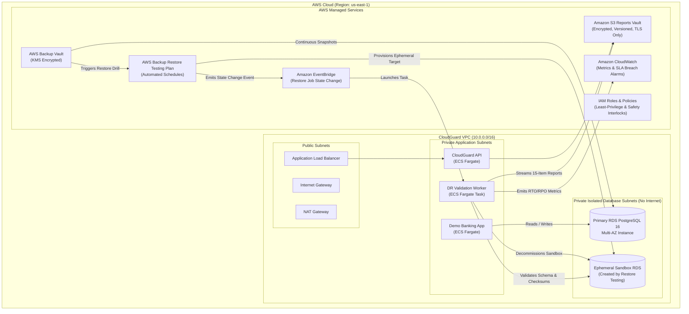
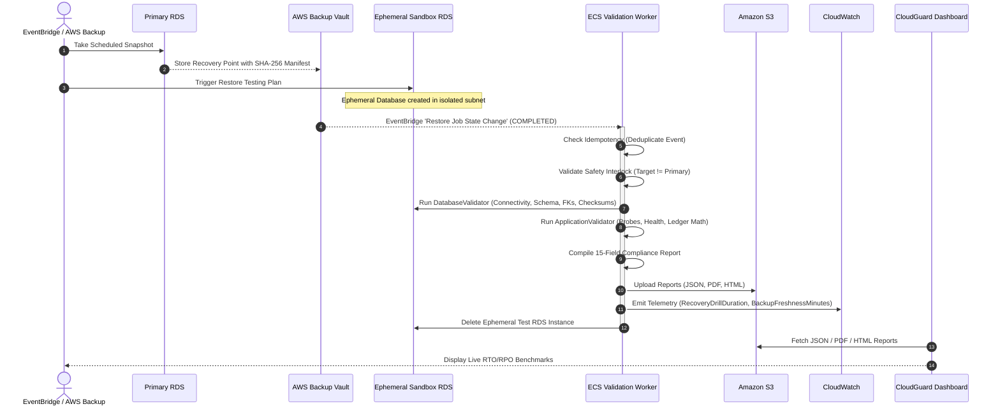

# CloudGuard Architecture & Engineering Specification

CloudGuard is an automated AWS Disaster Recovery (DR) Verification, Monitoring, and Compliance Reporting platform. It validates whether PostgreSQL databases and containerized FastAPI applications can be successfully restored from backups in an isolated sandbox environment without mutating production state.

---

## 1. High-Level AWS Architecture



---

## 2. Disaster Recovery Verification Pipeline



---

## 3. Network Architecture & Strict Isolation

CloudGuard employs a strict 3-tier VPC architecture:
1. **Public Subnets**: Houses NAT Gateways and ALBs. No database instances are ever placed here.
2. **Private Application Subnets**: Hosts ECS Fargate tasks (`cloudguard-api`, `demo-banking-application`, `cloudguard-validation-worker`). Outbound internet access via NAT Gateway for ECR pulls.
3. **Private Isolated Database Subnets**:
   - Zero internet access.
   - Zero NAT Gateway routes.
   - Port 5432 ingress restricted strictly to the ECS task security group.
   - Both the Primary RDS instance and ephemeral restored sandbox instances reside here.

---

## 4. Safety Guardrails & Primary Protection

To prevent disastrous production data loss or accidental overwrites during DR drills, CloudGuard enforces three layers of safety interlocks:

1. **IAM Level (Hard Interlock)**:
   - The validation worker IAM policy contains an explicit `Deny` on `rds:DeleteDBInstance` targeted directly at the Primary RDS ARN:
   ```json
   {
     "Sid": "SafetyInterlockDenyPrimaryDeletion",
     "Effect": "Deny",
     "Action": ["rds:DeleteDBInstance"],
     "Resource": ["arn:aws:rds:*:*:db:cloudguard-rds-primary*"]
   }
   ```
2. **Code Level (Safety Interlock Engine)**:
   - `validate_isolated_target_safety()` compares normalized source and target URLs.
   - If target URL is identical to source URL, or target name lacks sandbox tokens (`isolated`, `test`, `sandbox`, `drill`), execution halts immediately.
3. **Naming & Tagging Policy**:
   - Ephemeral test databases are uniquely named `cloudguard-isolated-*` and tagged with `Environment=DR-Sandbox`.

---

## 5. Methodological Distinctions (SLA Definitions)

CloudGuard strictly adheres to industry DR standards:

### Recovery Time Objective (RTO)
- **Configured Target**: 300 Seconds (5 Minutes).
- **Observed Recovery Duration**: Time measured from start of sandbox restore until validation suite completion.
- **Methodological Distinction**:
  > *Observed recovery drill duration reflects synthetic sandbox restore + validation time. Actual production RTO includes DNS cutover, traffic diversion, replication catching up, and application cluster scaling.*

### Recovery Point Objective (RPO)
- **Configured Target**: 60 Minutes (1 Hour).
- **Observed Backup Age**: Elapsed time between recovery point snapshot timestamp and drill start time.
- **Methodological Distinction**:
  > *Backup age reflects snapshot freshness at drill execution. Actual RPO requires transaction log / WAL replay analysis and transaction ledger gap verification; snapshot age alone does not guarantee zero data loss.*
